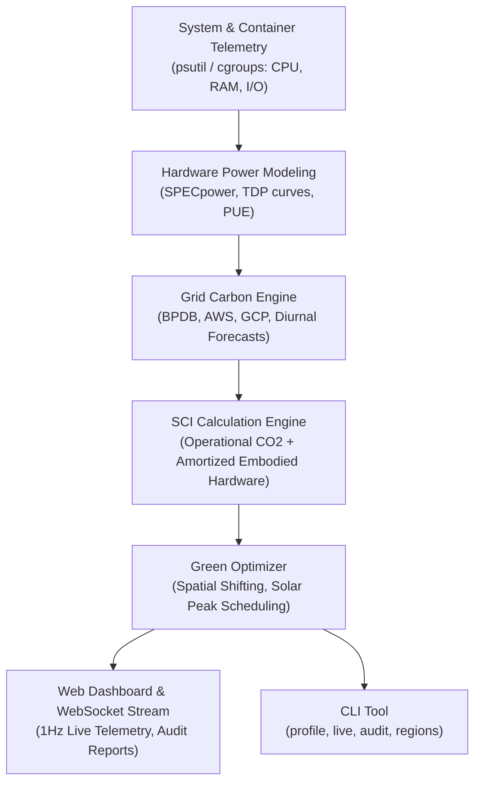

# EcoTrace

> **Real-time cloud energy profiler and green scheduling optimizer.**  
> Built according to the [Green Software Foundation (GSF)](https://greensoftware.foundation/) Software Carbon Intensity (SCI) specification.

EcoTrace monitors the electrical consumption of host systems and containerized workloads, maps their draw against regional power grid emission factors (including Bangladesh BPDB and global cloud regions), and suggests actionable spatial and temporal scheduling optimizations to lower emissions.

---

## The Problem

Software does not directly emit carbon—hardware consumes electrical power generated by regional grids. 

* Running a machine learning batch job or a data pipeline in **Bangladesh (BPDB National Grid)** emits **$\approx 500 - 640\,\text{gCO}_2/\text{kWh}$** due to heavy reliance on natural gas, imported coal, and heavy fuel oil.
* If load shedding occurs and local server rooms switch to captive diesel backup generators, carbon intensity spikes above **$780\,\text{gCO}_2/\text{kWh}$** with electricity costs exceeding **$\text{৳}22/\text{kWh}$**.
* Running the identical job in **Europe North (`eu-north-1`, Sweden)** emits only **$21\,\text{gCO}_2/\text{kWh}$** from hydro and nuclear baseload—an immediate **$94\%$ reduction in carbon footprint**.

EcoTrace provides the tooling to measure these differences continuously and automate low-carbon scheduling.

---

## System Architecture



---

## Mathematical Formulation

### 1. Power Consumption Model
$$\text{Power}_{\text{total}} = \left( P_{\text{cpu}} + P_{\text{mem}} + P_{\text{disk}} + P_{\text{net}} \right) \times \text{PUE}$$

Where:
* $P_{\text{cpu}} = P_{\text{idle}} + (P_{\text{max}} - P_{\text{idle}}) \times \frac{\text{CPU}\%}{100}$
  * Average server vCPU TDP: $18\,\text{Watts}$.
  * Idle baseline power draw: $18\%$ of max TDP.
* $P_{\text{mem}} = \text{RAM}_{\text{GB}} \times 0.38\,\text{W/GB}$
* $P_{\text{disk}} = (\text{Read}_{\text{MB/s}} + \text{Write}_{\text{MB/s}}) \times 0.0008\,\text{W/(MB/s)}$
* $P_{\text{net}} = (\text{Recv}_{\text{MB/s}} + \text{Sent}_{\text{MB/s}}) \times 0.0012\,\text{W/(MB/s)}$
* $\text{PUE}$ (Power Usage Effectiveness): $1.10 - 1.28$ for modern hyperscalers / Tier-IV datacenters; up to $1.65$ for legacy or diesel-backed server rooms.

### 2. Software Carbon Intensity (GSF SCI 1.0)
$$\text{SCI} = (E \times I) + M$$

* $E$ = Total kilowatt-hours ($\text{kWh}$) consumed.
* $I$ = Real-time grid emission factor ($\text{gCO}_2\text{eq/kWh}$) including diurnal solar curves.
* $M$ = Embodied hardware carbon amortized over a 4-year server lifecycle ($0.557\,\text{gCO}_2\text{eq}$ per vCPU-hour).

---

## Datacenter Nodes Modeled

| Region ID | Facility / Region | Baseline Intensity | PUE | Electricity Tariff |
|---|---|---|---|---|
| `bd-tier4-gazipur` | Bangladesh National Tier-IV (Gazipur) | $503 - 585\,\text{gCO}_2/\text{kWh}$ | 1.28 | $\text{৳}11.85 / \text{kWh}$ |
| `bd-dhaka-colocation` | Dhaka BDIX Colocation & Telecom Hub | $516 - 615\,\text{gCO}_2/\text{kWh}$ | 1.48 | $\text{৳}12.50 / \text{kWh}$ |
| `bd-enterprise-dg` | Dhaka Enterprise Server (Grid + Diesel Generator) | $643 - 780\,\text{gCO}_2/\text{kWh}$ | 1.65 | $\text{৳}22.00 / \text{kWh}$ |
| `ap-south-1` | AWS Mumbai (Closest AWS Region) | $560 - 640\,\text{gCO}_2/\text{kWh}$ | 1.15 | $\text{৳}12.00 / \text{kWh}$ |
| `ap-southeast-1` | AWS Singapore (Regional SEA Node) | $390 - 415\,\text{gCO}_2/\text{kWh}$ | 1.25 | $\text{৳}14.50 / \text{kWh}$ |
| `eu-north-1` | AWS Stockholm (Hydro & Nuclear) | $21 - 25\,\text{gCO}_2/\text{kWh}$ | 1.10 | $\text{৳}9.20 / \text{kWh}$ |
| `ca-central-1` | AWS Montreal (Hydro-Québec) | $30 - 35\,\text{gCO}_2/\text{kWh}$ | 1.12 | $\text{৳}8.50 / \text{kWh}$ |
| `us-east-1` | AWS N. Virginia | $320 - 375\,\text{gCO}_2/\text{kWh}$ | 1.18 | $\text{৳}11.00 / \text{kWh}$ |

---

## Quickstart

### Installation
```bash
git clone https://github.com/Jobaer-Hossain/ecotrace.git
cd ecotrace

pip install -r requirements.txt
```

### 1. Start the Web Dashboard & API Server
```bash
python run.py --port 8000
```
Open **`http://localhost:8000`** in your browser.

### 2. Command-Line Profiling

#### Profile an execution script or command
```bash
python -m ecotrace.cli profile --cmd="python train.py" --region="bd-tier4-gazipur"
```

#### Run a green carbon audit on workloads
```bash
python -m ecotrace.cli audit
```

#### List regional carbon intensities and grid status
```bash
python -m ecotrace.cli regions
```

#### Launch real-time terminal monitor
```bash
python -m ecotrace.cli live
```

---

## API Reference

| Endpoint | Method | Description |
|---|---|---|
| `/api/status` | `GET` | Service status, uptime, and active simulation region |
| `/api/metrics/live` | `GET` | Current power (Watts), carbon rate (g/h), and cumulative energy |
| `/api/metrics/history` | `GET` | 60-second time-series buffer for charts |
| `/api/workloads` | `GET`, `POST` | Monitored microservice workloads |
| `/api/workloads/{id}` | `DELETE` | Remove a monitored workload |
| `/api/regions` | `GET` | Global datacenter regions and 24h carbon forecasts |
| `/api/regions/active` | `POST` | Switch active simulation region |
| `/api/optimizer/recommendations` | `GET` | Active spatial and temporal shift recommendations |
| `/api/optimizer/apply` | `POST` | Apply an optimization to a workload |
| `/api/optimizer/calculate` | `POST` | What-If custom job carbon & cost estimator |
| `/api/export/report` | `GET` | Download full JSON audit report |
| `/ws/stream` | `WebSocket` | Real-time 1Hz telemetry broadcast |

---

## Running Automated Tests
```bash
python -m unittest tests.test_ecotrace
```

---

## License
MIT License. Free for open-source and commercial use.
